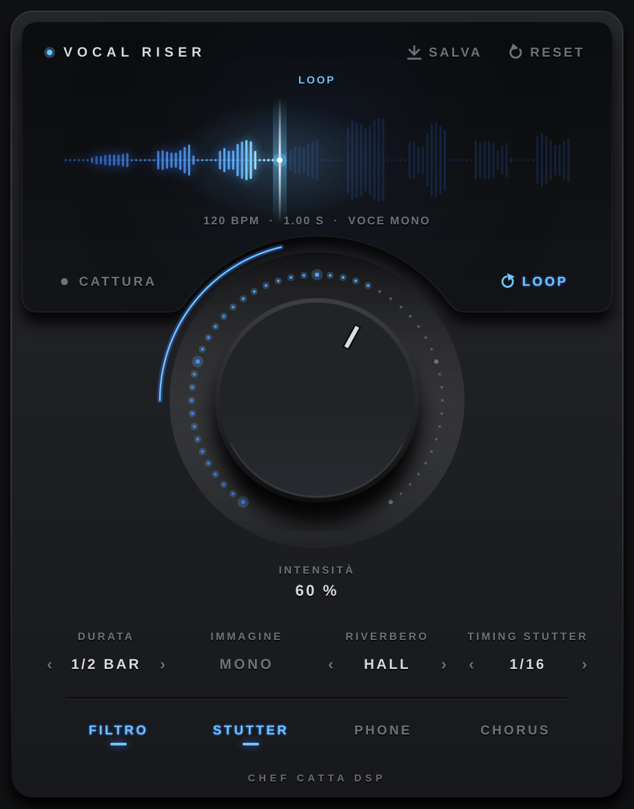

# Vocal Riser

**CHEF CATTA dsp**

Plugin per creare **riser vocali** in pochi secondi, direttamente in sessione. Ascolta la frase, prende l'attacco della prima parola e lo trasforma in una coda riversata e allungata, a tempo col progetto, da trascinare nella timeline.



## ⬇️ Download

**[Scarica l'ultima versione](https://github.com/chefcatta/Vocal-Riser/releases/latest)**: nella pagina che si apre, sotto *Assets*:

- **VocalRiser-mac.zip**: Mac (Apple Silicon e Intel), Audio Unit + VST3
- **VocalRiser-windows.zip**: Windows 64 bit, VST3

Funziona con Logic Pro, GarageBand, Ableton Live, FL Studio, Cubase, Studio One, Reaper, Bitwig e tutte le DAW che leggono Audio Unit o VST3. Pro Tools (AAX) non è ancora supportato.

📖 **Istruzioni di installazione per ogni DAW: [INSTALLAZIONE.md](INSTALLAZIONE.md)**

## Come si usa

1. Metti **Vocal Riser** come insert sulla traccia della voce.
2. Premi **CATTURA**, porta il playhead poco prima della frase e premi **play**: il plugin ascolta la frase.
3. Gira la manopola **INTENSITÀ** e scegli la **DURATA** (1/4, 1/2, 1 o 2 battute, a tempo col progetto).
4. Accendi **LOOP**: con la DAW ferma il plugin suona il riser in loop, così lo regoli a orecchio. In Logic tieni selezionata la traccia.
5. **Trascina la forma d'onda** su una traccia audio: il riser finisce esattamente dove attacca la voce, quindi allinea la **fine** della clip all'inizio della frase.

**SALVA** scrive il WAV (24 bit) in `Documenti/Vocal Riser`. **RESET** riporta i controlli ai valori iniziali.

| Controllo | Cosa fa |
|---|---|
| INTENSITÀ | Quanto è lunga, piena e aperta la coda |
| DURATA | 1/4, 1/2, 1 o 2 battute |
| AMBIENTE | **HALL** (sala ampia), **PLATE** (denso e brillante), **SPACE** (coda enorme, scura e morbida) |
| IMMAGINE | Voce mono: **MONO** o **STEREO**. Voce stereo: il riser resta stereo |
| FILTRO | Passa-alto che si apre durante il riser |
| STUTTER | Ripetizioni costanti, allineate all'attacco della voce. **TIMING**: 1/4, 1/8, 1/16 |
| PHONE | Suono "telefono" |
| CHORUS | Allarga e ammorbidisce la coda |

Nel riser non c'è voce dry: l'attacco della prima parola (il primo 40%, tra 80 e 250 ms) viene rovesciato e mandato in eco e riverbero al 100% wet. Si tiene solo la coda, che viene riversata e allungata (time-stretch) fino alla durata scelta.

---

## Per sviluppatori

Il plugin è scritto in C++ con [JUCE](https://juce.com) 8. Ogni push su `main` avvia la build su GitHub Actions (Mac universale e Windows) e pubblica i file nella pagina **Releases** con il numero di versione indicato in `CMakeLists.txt` (`project(VocalRiser VERSION ...)`). Per una nuova release basta aumentare quel numero.

Build in locale (CMake 3.22+, Xcode o Visual Studio 2022):

```
cmake -B build -DCMAKE_BUILD_TYPE=Release
cmake --build build --config Release
```

**Pro Tools (AAX):** con l'AAX SDK di Avid si attiva con `-DVR_AAX_SDK_PATH=/percorso/aax-sdk`. Per caricarlo nella versione normale di Pro Tools il plugin va poi firmato con PACE (wraptool).
