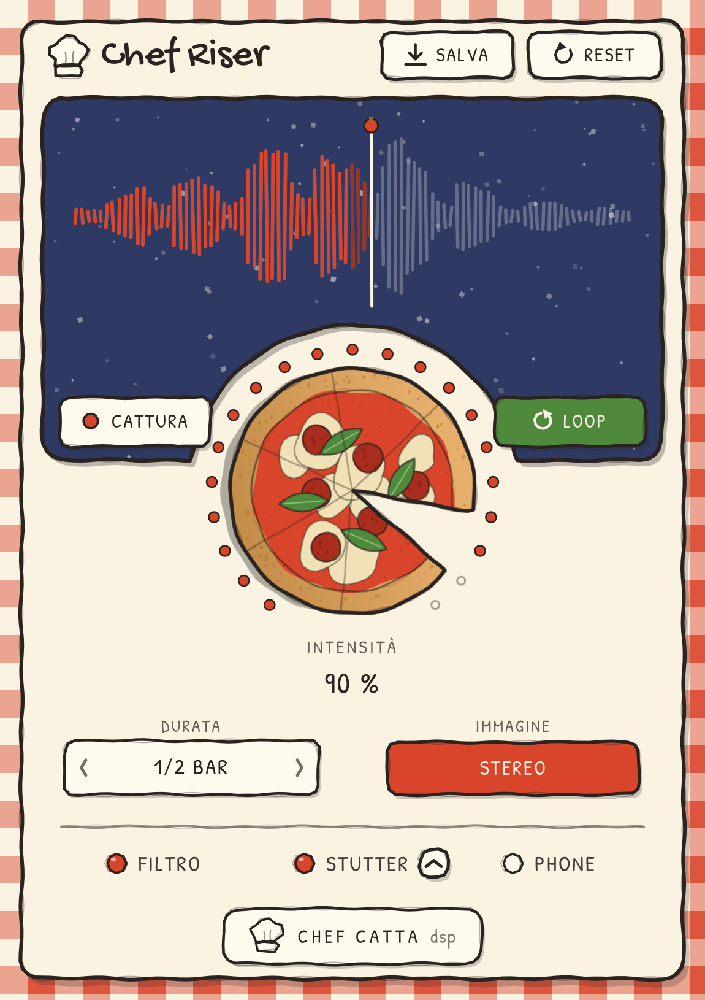

# Chef Riser

**CHEF CATTA dsp**

Plugin per creare **riser vocali** in pochi secondi, direttamente in sessione. Ascolta la frase, prende l'attacco della prima parola e lo trasforma in una coda riversata e allungata, a tempo col progetto, da trascinare nella timeline.



**Indice:** [Download](#download) · [Installazione su Mac](#installazione-su-mac) · [Installazione su Windows](#installazione-su-windows) · [Far trovare il plugin alla DAW](#far-trovare-il-plugin-alla-daw) · [Come si usa](#come-si-usa) · [Pro Tools](#pro-tools) · [Problemi frequenti](#problemi-frequenti)

---

## Download

**[Scarica l'ultima versione](https://github.com/chefcatta/Vocal-Riser/releases/latest)**: nella pagina che si apre, sotto *Assets*:

| Computer | File | Cosa contiene |
|---|---|---|
| Mac (Apple Silicon e Intel, macOS 11 o successivo) | `ChefRiser-mac.zip` | `Chef Riser.component` (Audio Unit) e `Chef Riser.vst3` |
| Windows 10/11 a 64 bit | `ChefRiser-windows.zip` | `Chef Riser.vst3` |

Su Mac c'è un modo ancora più semplice: l'[installazione con un comando](#metodo-1-con-un-comando-consigliato), che scarica e installa tutto da sola.

**Quale formato usa la tua DAW:**

| DAW | Mac | Windows |
|---|---|---|
| Logic Pro, GarageBand | Audio Unit (`.component`) | — |
| Ableton Live | VST3 (oppure Audio Unit) | VST3 |
| FL Studio | VST3 | VST3 |
| Cubase, Nuendo | VST3 | VST3 |
| Studio One | VST3 (oppure Audio Unit) | VST3 |
| Reaper | VST3 (oppure Audio Unit) | VST3 |
| Bitwig Studio | VST3 | VST3 |
| Pro Tools | non ancora disponibile, [vedi sotto](#pro-tools) | non ancora disponibile |

---

## Installazione su Mac

### Metodo 1: con un comando (consigliato)

Apri il **Terminale** (Cmd + Spazio, scrivi «Terminale»), incolla questa riga e premi Invio:

```
curl -fsSL https://raw.githubusercontent.com/chefcatta/Vocal-Riser/main/install-mac.sh | bash
```

- Scarica l'ultima versione e la installa in **Macintosh HD → Libreria → Audio → Plug-Ins**: Audio Unit in *Components*, VST3 in *VST3*.
- Ti chiede la password del Mac: mentre la scrivi non compare nulla, è normale.
- Scaricato così, il plugin **non fa comparire l'avviso di sicurezza di macOS**.
- Se c'era una versione precedente (anche la vecchia «Vocal Riser»), la sostituisce.
- **Per aggiornare** a una nuova versione basta rilanciare la stessa riga.

Poi passa a [Far trovare il plugin alla DAW](#far-trovare-il-plugin-alla-daw).

### Metodo 2: a mano

1. Scarica `ChefRiser-mac.zip` e fai doppio clic per decomprimerlo.
2. Nel Finder premi **Cmd + Shift + G**, incolla il percorso e trascina il file nella cartella:
   - `Chef Riser.component` → `/Library/Audio/Plug-Ins/Components`
   - `Chef Riser.vst3` → `/Library/Audio/Plug-Ins/VST3`

   Copia tutti e due, così il plugin funziona in qualsiasi DAW. Se il Finder chiede la password o se sostituire un file, conferma.
3. **Sblocca il plugin.** Il plugin non è firmato da Apple, quindi macOS blocca i file scaricati dal browser. Nel **Terminale** incolla queste due righe e premi Invio:
   ```
   sudo xattr -cr "/Library/Audio/Plug-Ins/Components/Chef Riser.component"
   sudo xattr -cr "/Library/Audio/Plug-Ins/VST3/Chef Riser.vst3"
   ```
   In alternativa: quando la DAW mostra l'avviso *«Chef Riser… non è stata aperta»*, premi **Fine** (non «Sposta nel Cestino»). Poi vai su **Impostazioni di Sistema → Privacy e sicurezza**, scorri fino a **Sicurezza** e premi **«Apri comunque»**.

> **Le cartelle Libreria sono due.** `/Library` è **Macintosh HD → Libreria**, dove stanno anche tutti gli altri tuoi plugin: è quella giusta. La cartella *Libreria* dentro il tuo utente (Utenti → nome → Libreria) è un'altra ed è nascosta di default.

> **Avevi la versione precedente «Vocal Riser»?** Ora il plugin si chiama **Chef Riser**. Cancella i vecchi `Vocal Riser.component` e `Vocal Riser.vst3` dalle stesse cartelle: il metodo 1 lo fa da solo. Le sessioni in cui l'avevi già usato si aprono con Chef Riser.

---

## Installazione su Windows

1. Scarica `ChefRiser-windows.zip`. **Prima di decomprimerlo** fai clic destro → **Proprietà**: se in basso c'è la casella **«Sblocca»**, spuntala e premi OK.
2. Clic destro sullo zip → **Estrai tutto**.
3. Copia la cartella `Chef Riser.vst3` in:
   ```
   C:\Program Files\Common Files\VST3
   ```
   Windows chiederà il permesso di amministratore: conferma.

Non serve installare nient'altro (il runtime di Visual C++ è già incluso nel plugin).

---

## Far trovare il plugin alla DAW

Dopo l'installazione apri (o riavvia) la DAW e fai una nuova scansione dei plugin. Lo sviluppatore è **Chef Catta** e il plugin si chiama **Chef Riser**.

### Logic Pro (Mac)
1. Apri Logic. Di solito scansiona da solo i nuovi plugin.
2. Se non compare: **Logic Pro → Impostazioni → Plug-in Manager**. Cerca **«Chef»**, seleziona la riga e premi **Reset & Rescan Selection** (in basso a sinistra). Controlla che la casella **Usa** sia spuntata.
3. Su una traccia audio: slot **Audio FX → Audio Units → Chef Catta → Chef Riser**.

### GarageBand (Mac)
1. Seleziona la traccia della voce e apri gli **Smart Controls** (tasto B), poi la sezione **Plug-in**.
2. In uno slot vuoto scegli **Audio Units → Chef Catta → Chef Riser**.

### Ableton Live (Mac e Windows)
1. **Impostazioni** (Mac: *Live → Impostazioni*; Windows: *Options → Preferences*) → scheda **Plug-in**.
2. Attiva **Usa cartelle di sistema per plug-in VST3** («Use VST3 Plug-In System Folders»). Su Mac puoi attivare anche **Usa Audio Units**.
3. Premi **Ripeti scansione** (Rescan).
4. Nel browser, sotto **Plug-in**, apri **Chef Catta** e trascina **Chef Riser** sulla traccia della voce.

### FL Studio (Mac e Windows)
1. **Options → Manage plugins**.
2. Premi **Find installed plugins** (oppure *Start scan*) e attendi la fine della scansione.
3. Nel Mixer, sulla traccia della voce, apri uno slot vuoto e scegli **Chef Riser**. Lo trovi anche nel *Plugin database*, sotto *Effects*.

### Cubase / Nuendo (Mac e Windows)
1. Cubase scansiona i plugin VST3 all'avvio: riavvialo dopo l'installazione.
2. Se non lo vedi: **Studio → VST Plug-in Manager**. Se è nella lista dei plug-in bloccati, selezionalo e riattivalo.
3. Sulla traccia della voce: **Insert → Chef Catta → Chef Riser**.

### Studio One (Mac e Windows)
1. Studio One scansiona i plugin all'avvio: riavvialo.
2. Se non compare: **Studio One → Opzioni** (Windows: *Options*) → **Posizioni → Plug-in VST**. Controlla che ci sia la cartella VST3 di sistema, premi **Reimposta blocklist** e riavvia.
3. Nel browser **Effetti** trovi **Chef Riser** sotto **Chef Catta**: trascinalo sulla traccia.

### Reaper (Mac e Windows)
1. **Options → Preferences → Plug-ins → VST**.
2. Controlla che il percorso dei VST3 sia incluso e premi **Re-scan** (oppure *Clear cache/re-scan*).
3. Sulla traccia: pulsante **FX → Add → All plugins → Chef Riser (Chef Catta)**. Su Mac lo trovi anche tra gli **AU**.

### Bitwig Studio (Mac e Windows)
1. **Settings → Locations**: controlla che la posizione VST3 predefinita sia attiva. Bitwig scansiona da solo.
2. Nel browser dei dispositivi cerca **Chef Riser** e trascinalo sulla traccia.

---

## Come si usa

1. Metti **Chef Riser** come effetto (insert) sulla traccia della voce.
2. Premi **CATTURA**, porta il playhead poco prima della frase e premi **play**: il plugin ascolta la frase.
3. Gira la manopola **INTENSITÀ** e scegli la **DURATA** (1/4, 1/2, 1 o 2 battute, a tempo col progetto).
4. Accendi **LOOP**: con la DAW ferma il plugin suona il riser in loop, così lo regoli a orecchio. In Logic tieni selezionata la traccia.
5. **Trascina la forma d'onda** su una traccia audio: il riser finisce esattamente dove attacca la voce, quindi allinea la **fine** della clip all'inizio della frase.

**SALVA** scrive il WAV (24 bit) in `Documenti/Chef Riser`: utile se la tua DAW non accetta il trascinamento dal plugin. **RESET** riporta i controlli ai valori iniziali (il riser catturato resta). Il riser catturato viene salvato anche nel progetto: riaprendo la sessione lo ritrovi.

| Controllo | Cosa fa |
|---|---|
| INTENSITÀ | Quanto è lunga, piena e aperta la coda |
| DURATA | 1/4, 1/2, 1 o 2 battute |
| AMBIENTE | **HALL** (sala ampia), **PLATE** (denso e brillante), **SPACE** (coda enorme, scura e morbida) |
| IMMAGINE | Voce mono: **MONO** o **STEREO**. Voce stereo: il riser resta stereo e mantiene l'immagine della sorgente |
| FILTRO | Passa-alto che si apre durante il riser |
| STUTTER | Ripetizioni costanti, allineate all'attacco della voce. **TIMING**: 1/4, 1/8, 1/16 |
| PHONE | Suono "telefono" (banda stretta + saturazione) |
| CHORUS | Allarga e ammorbidisce la coda |

Nel riser non c'è voce dry: l'attacco della prima parola (il primo 40%, tra 80 e 250 ms) viene rovesciato e mandato in eco e riverbero al 100% wet. Si tiene solo la coda, che viene riversata e allungata (time-stretch, senza cambiare l'intonazione) fino alla durata scelta.

---

## Pro Tools

Pro Tools usa solo il formato **AAX** di Avid, che per ora non è disponibile per Chef Riser. Per crearlo servono il kit di sviluppo di Avid e una firma digitale (PACE/iLok), senza la quale Pro Tools non carica il plugin.

Nel frattempo puoi:
- usare Chef Riser in un'altra DAW, anche gratuita (per esempio Reaper in prova), salvare il riser con **SALVA** e importare il WAV in Pro Tools;
- oppure usare un plugin "contenitore" AAX che carica i VST3 dentro Pro Tools, come **Blue Cat's PatchWork** (prodotto a pagamento di terze parti).

---

## Problemi frequenti

- **Mac: «non è stata aperta» o «è danneggiato».** Usa l'[installazione con un comando](#metodo-1-con-un-comando-consigliato), oppure esegui i comandi `xattr` del metodo 2, oppure premi «Apri comunque» in *Privacy e sicurezza*. Poi rifai la scansione nella DAW.
- **`xattr: No such file`.** Il plugin non è ancora nella cartella: va copiato prima di sbloccarlo. Il metodo 1 fa entrambe le cose.
- **La DAW non trova il plugin.** Controlla che sia in *Macintosh HD → Libreria → Audio → Plug-Ins* (Mac) o in `C:\Program Files\Common Files\VST3` (Windows) e fai una nuova scansione.
- **Windows: il plugin non compare.** La cartella copiata deve chiamarsi `Chef Riser.vst3` ed essere dentro `C:\Program Files\Common Files\VST3`. Le DAW a 32 bit non sono supportate.
- **Il loop non si sente in Logic.** Seleziona la traccia su cui c'è il plugin: a trasporto fermo Logic fa lavorare solo la traccia selezionata. Se sul display compare «LOOP: SELEZIONA LA TRACCIA», è proprio questo il motivo.
- **Aggiornare a una nuova versione.** Su Mac rilancia il comando del metodo 1. Altrimenti chiudi la DAW, sostituisci i file nelle stesse cartelle (su Mac sbloccali di nuovo) e riapri. I riser catturati nelle sessioni salvate restano.

---

## Per sviluppatori

Il plugin è scritto in C++ con [JUCE](https://juce.com) 8. Ogni push su `main` che tocca il codice avvia la build su GitHub Actions (Mac universale e Windows) e pubblica i file nella pagina **Releases** con il numero di versione indicato in `CMakeLists.txt` (`project(VocalRiser VERSION ...)`). Per una nuova release basta aumentare quel numero.

Build in locale (CMake 3.22+, Xcode o Visual Studio 2022):

```
cmake -B build -DCMAKE_BUILD_TYPE=Release
cmake --build build --config Release
```

**Pro Tools (AAX):** con l'AAX SDK di Avid si attiva con `-DVR_AAX_SDK_PATH=/percorso/aax-sdk`. Per caricarlo nella versione normale di Pro Tools il plugin va poi firmato con PACE (wraptool).
